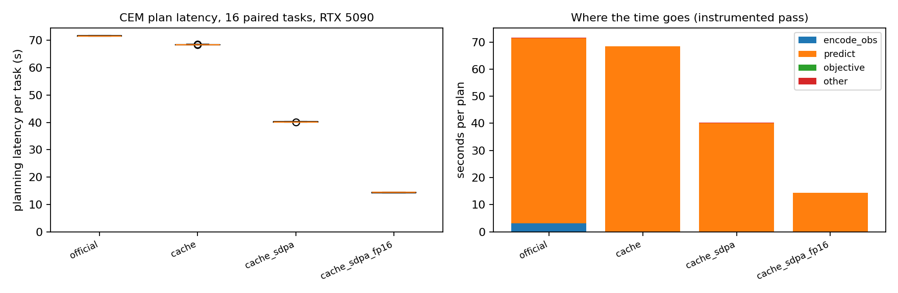

# Accelerating World-Model Planning with Reference-Conditioned Rollouts

COMS 6998 High Performance Machine Learning, Fall 2026, Project Team 28
(Huaiyu Chen, Wesley Maa, Ethan Yang, Rebecca Yu).

This repo holds the planning benchmark for the project: the official DINO-WM world model and CEM planner on PushT,
timed and profiled, plus the planner optimizations we compare against it.

## What is measured

One *plan* is one task: 30 CEM iterations x 300 candidate action sequences x horizon 5 (frameskip 5), top-30 elites,
objective = feature MSE to the goal frame at the last step. These are the CEM settings of the official
`conf/plan_pusht.yaml`. The plan is executed open loop in the PushT simulator and scored with the official success test.
Simulator evaluation and early stopping inside the CEM loop are off, so latency is planning only.

| variant | what changes |
|---|---|
| `official` | DINO-WM as released (commit `0a9492f`), unmodified |
| `cache` | start frame encoded once per plan instead of once per candidate per iteration |
| `cache_sdpa` | `cache` + predictor attention through `F.scaled_dot_product_attention` (same frame-causal mask) |
| `cache_sdpa_fp16` | `cache_sdpa` + fp16 autocast inside the rollout |

Every variant plans the same tasks with the same candidate noise, on the same GPU, in one process.
`bench/planbench.py` applies the variants by patching at run time; the DINO-WM source is never edited.

## Results

One RTX 5090, fp32 unless named, 16 paired tasks, warm-up 1 plan, seed 99 (`results/mid_seed99/`):

| variant | median plan (s) | peak GPU memory (MB) | speedup vs official [95% CI] | success |
|---|---|---|---|---|
| `official` | 71.61 | 18507 | 1.00x | 16/16 |
| `cache` | 68.43 | 18598 | 1.05x [1.05, 1.05] | 16/16 |
| `cache_sdpa` | 40.21 | 5217 | 1.78x [1.78, 1.78] | 16/16 |
| `cache_sdpa_fp16` | 14.36 | 3740 | 4.99x [4.98, 4.99] | 16/16 |

The predictor rollout is 95.5% of an official plan and its cost is linear in the number of candidates.
Full tables (phase split, profiler kernels, rollout cost vs candidates, equivalence checks):
`results/mid_seed99/summary.md`. The report draft is `docs/midpoint_draft.md`.



Each run folder under `results/` holds `results.json`, `summary.md`, figures, profiler tables and rollout images.

## Reproduce

Needs an NVIDIA GPU, Python 3.12, and the packages in `requirements.txt` (exact versions used: `results/env_freeze.txt`).

1. Clone DINO-WM at `0a9492fa12044b852ae9e001cc74604b79c8bb0c`; download `checkpoints/outputs.zip` and
   `datasets/pusht_noise.zip` from the DINO-WM OSF page (https://osf.io/bmw48/) and unzip them.
2. Lay them out under one folder `$HPML_W`: `dino_wm/`, `ckpt/outputs/pusht/`, `data/pusht_noise/`.
3. Run from inside `dino_wm/`:

```bash
HPML_W=/path/to/folder DATASET_DIR=$HPML_W/data TORCH_FORCE_NO_WEIGHTS_ONLY_LOAD=1 SDL_VIDEODRIVER=dummy \
  python /path/to/bench/planbench.py --out runs/mid_seed99 --n-tasks 16 --phase-tasks 2 --profile --scaling
python bench/summarize.py runs/mid_seed99/results.json
```

`planbench.py` starts with a self-check that the optimized rollouts match the official rollout on the same inputs.
`--device cpu --n-tasks 2 --num-samples 8 --opt-steps 2` is a quick functional dry run.

## Track existing results with Weights & Biases

`bench/import_wandb.py` imports saved JSON files without loading DINO-WM, PyTorch, datasets,
or a GPU. Run these commands from the repository root. The authentication-free preview uses
only Python's standard library and prints the exact configuration, summary metrics and table
contents planned for upload:

```bash
python bench/import_wandb.py --results results/smoke results/mid_seed99/results.json --dry-run > /tmp/wandb-preview.json
```

This produces eight planned runs: one per recorded variant per result file, with two tasks per
smoke variant and sixteen per midpoint variant. `--results` accepts one or more JSON files or
directories containing `results.json`, and can be repeated. `--entity` and `--project` also work
with `--dry-run`; the default project is `hpml-world-model-planning`.

For upload, install the lightweight dependency set in a virtual environment (Python 3.12 is
the benchmark environment; the importer is also tested with Python 3.11):

```bash
python -m venv .venv
source .venv/bin/activate
python -m pip install -r requirements-wandb.txt
wandb login
python bench/import_wandb.py --results results/smoke results/mid_seed99 \
  --entity YOUR_USER_OR_TEAM --project hpml-world-model-planning
```

`wandb login` prompts for your W&B API key; it is not an argument to the importer. For
noninteractive use, supply `WANDB_API_KEY` through your environment or secret manager. Keep
credentials out of source files and result JSON. Local `wandb/`, `.venv/` and `.env` files are
ignored by Git. The full benchmark requirements include the same W&B pin, `0.31.2`, matching
`results/env_freeze.txt`. See the [W&B SDK authentication reference](https://github.com/wandb/wandb/blob/v0.31.2/wandb/sdk/wandb_login.py).

Each run is named `historical-<folder>-<variant>`, tagged `historical` and `imported`, and has
job type `historical-import`. Runs from one source document share a group. W&B timestamps and
runtime describe the import; the importer does not infer the original experiment date.
Automatic machine metadata, system metrics, code and Git capture are disabled, so the import
machine's hardware is not substituted for the recorded benchmark hardware.

The W&B payload preserves:

- **Config:** the complete original `meta` object under `benchmark`, including hardware, software,
  the original dtype description (including the fp16 autocast qualification), CEM configuration,
  seed, warm-up, repetitions, timer and original command arguments. `import` records provenance,
  hashes, schema version, `historical: true` and `experiments_executed: false`.
- **Summary:** recorded latency statistics, candidates/s throughput, peak allocated/reserved
  memory, success rate, evaluation metrics and phase timings under `recorded/`. The original
  memory fields are labelled MB but measured in MiB (`bytes / 2**20`) by `planbench.py`.
  `selfcheck/` and `reference/` retain the shared correctness and reference measurements on each
  run, including false flags; variant-specific checks retain their original variant names.
- **Tables:** `tasks` retains zero-based paired task indices, latency, success, state distance,
  complete CEM loss traces and actions. Traces and actions are lossless JSON strings in W&B
  table cells. `scaling` and `profile_top_ops` retain each variant's recorded rows, including
  scaling warm-up/repetitions and OOM rows when present. Missing cells are null, not zero.
- **Artifact:** a `benchmark-results` artifact retains the complete, byte-for-byte source JSON,
  including any fields not exposed as metrics. Every variant links the source artifact.

No missing summary metrics are calculated or filled in. No confidence intervals, throughput
definitions, or precision settings are inferred from variant names. Task arrays are checked
for consistent lengths and against `meta.n_tasks` when present; malformed/nonfinite inputs
fail validation before any uploads. Inputs must contain a nonempty `variants` object of plan
results; scaling-only files from `--skip-plans` are not supported.

Run IDs are deterministic SHA-256 hashes of the canonical JSON document and variant name.
Moving/copying/reformatting the same JSON keeps the same IDs. Repeated source paths in one
invocation are deduplicated. Uploads use W&B's `resume="allow"` semantics for those IDs and
skip data logging when `import/complete` is already set. Interrupted imports reuse the same
run; a retry after partial logging may add another table history entry, while retaining one
run and one row per task in the current table. Run imports serially for a given destination.
Changed source content creates new IDs; a different entity or project is a separate destination.
See the [W&B SDK run initialization reference](https://github.com/wandb/wandb/blob/v0.31.2/wandb/sdk/wandb_init.py).

Run the CPU-only validation suite without W&B or authentication:

```bash
python -m unittest discover -s tests -v
```

With `requirements-wandb.txt` installed, opt into SDK serialization validation:

```bash
HPML_WANDB_SDK_TEST=1 python -m unittest discover -s tests -v
```

This uses W&B offline mode and temporary storage to serialize all eight runs and 24 tables.
It needs local W&B service sockets, but no authentication or remote uploads. Remote resume
and artifact-upload behavior are covered by mocked tests; they require a live account to
verify end to end.

## Credits

World model, planner, simulator and checkpoint: DINO-WM, Zhou et al. 2024 (https://github.com/gaoyuezhou/dino_wm, MIT).
