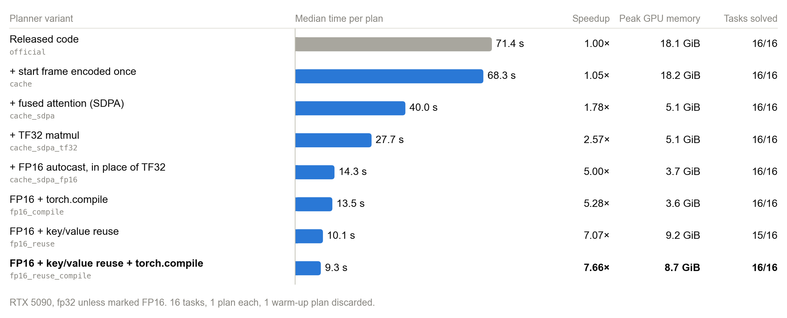

# Accelerating World-Model Planning with Reference-Conditioned Rollouts

COMS 6998 High Performance Machine Learning, Fall 2026, Project Team 28
(Huaiyu Chen, Wesley Maa, Ethan Yang, Rebecca Yu).

This repo holds the planning benchmark for the project: the official DINO-WM world model and CEM planner on PushT,
timed and profiled, plus the planner optimizations we compare against it.

## What is measured

One *plan* is one task: 30 CEM iterations x 300 candidate action sequences x horizon 5 (frameskip 5), top-30 elites,
objective = feature MSE to the goal frame at the last step. These are the CEM settings of the official
`conf/plan_pusht.yaml`. The plan is executed open loop in the PushT simulator and scored with the official success test.
Simulator evaluation and early stopping inside the CEM loop are off, so latency is planning only.

| variant | what changes |
|---|---|
| `official` | DINO-WM as released (commit `0a9492f`), unmodified |
| `cache` | start frame encoded once per plan instead of once per candidate per iteration |
| `cache_sdpa` | `cache` + predictor attention through `F.scaled_dot_product_attention` (same frame-causal mask) |
| `cache_sdpa_fp16` | `cache_sdpa` + fp16 autocast inside the rollout |

Every variant plans the same tasks with the same candidate noise, on the same GPU, in one process.
`bench/planbench.py` applies the variants by patching at run time; the DINO-WM source is never edited.

## Results

One RTX 5090, 16 paired tasks, 300 candidates per batch, warm-up 1 plan, seed 99 (`results/mid2_all/`, fp32 unless named):

| variant | median plan (s) | peak GPU memory (MiB) | speedup vs official [95% CI] | success |
|---|---|---|---|---|
| `official` | 71.36 | 18508 | 1.00x | 16/16 |
| `cache` | 68.27 | 18599 | 1.05x [1.05, 1.05] | 16/16 |
| `cache_sdpa` | 39.99 | 5217 | 1.78x [1.78, 1.78] | 16/16 |
| `cache_sdpa_tf32` | 27.72 | 5217 | 2.57x [2.57, 2.57] | 16/16 |
| `cache_sdpa_fp16` | 14.28 | 3740 | 5.00x [5.00, 5.00] | 16/16 |
| `fp16_compile` | 13.50 | 3704 | 5.28x [5.28, 5.29] | 16/16 |
| `fp16_reuse` | 10.09 | 9402 | 7.07x [7.07, 7.08] | 15/16 |
| `fp16_reuse_compile` | 9.32 | 8910 | 7.66x [7.66, 7.66] | 16/16 |

`cache_sdpa_tf32` adds TF32 matmul, `*_compile` adds `torch.compile`, and `*_reuse` caches earlier frames' keys and values
across rollout steps (exact in fp32: zero difference from the plain computation). The two compile rows come from a second
process on the same card (`results/mid2c_seed99/`, merged with `bench/merge_runs.py`); `cache_sdpa_fp16`, run in both,
measured 14.28 s and 14.29 s. `fp16_reuse` fails one borderline task. Last night's first run is in `results/mid_seed99/`.

The predictor rollout is 95.5% of an official plan and its cost is linear in the number of candidates.
Full tables (phase split, profiler kernels, rollout cost vs candidates, equivalence checks):
`results/mid2_all/summary.md`. The mid-point report is `docs/HPML_Midpoint_Report_Team28.pptx` (the course template, filled);
`docs/midpoint_report_text.md` is its text, exported from the deck.



Each run folder under `results/` holds `results.json`, `summary.md`, figures, profiler tables and rollout images.
The runs are also on Weights & Biases: https://wandb.ai/wesley-maa-columbia-university/hpml-wm-planning (see
"Track results with Weights & Biases" below).

`bench/draftscan.py` is a separate exploration (draft-and-verify scoring of CEM candidates), not part of these tables;
its first results are in `results/draft1/summary.md`.

## Reproduce

Needs an NVIDIA GPU, Python 3.12, and the packages in `requirements.txt` (exact versions used: `results/env_freeze.txt`).

1. Clone DINO-WM at `0a9492fa12044b852ae9e001cc74604b79c8bb0c`; download `checkpoints/outputs.zip` and
   `datasets/pusht_noise.zip` from the DINO-WM OSF page (https://osf.io/bmw48/) and unzip them.
2. Lay them out under one folder `$HPML_W`: `dino_wm/`, `ckpt/outputs/pusht/`, `data/pusht_noise/`.
3. Run from inside `dino_wm/`:

```bash
HPML_W=/path/to/folder DATASET_DIR=$HPML_W/data TORCH_FORCE_NO_WEIGHTS_ONLY_LOAD=1 SDL_VIDEODRIVER=dummy \
  python /path/to/bench/planbench.py --out runs/mid_seed99 --n-tasks 16 --phase-tasks 2 --profile --scaling
python bench/summarize.py runs/mid_seed99/results.json
```

`planbench.py` starts with a self-check that the optimized rollouts match the official rollout on the same inputs.
`--device cpu --n-tasks 2 --num-samples 8 --opt-steps 2` is a quick functional dry run.

## Track results with Weights & Biases

`bench/import_wandb.py` uploads saved `results.json` files to W&B without loading the model or a GPU. Each variant
becomes one run holding the recorded summary metrics, per-task and per-K series for charts, the task / scaling /
profiler tables, and the source JSON as an artifact. Nothing is re-measured; the only derived number is
`derived/speedup_vs_official`.

Preview what would be uploaded (standard library only, no login):

```bash
python bench/import_wandb.py --results results/mid2_all --dry-run
```

Upload (`wandb login` first, or set `WANDB_API_KEY`; the default project is `hpml-wm-planning`):

```bash
python -m pip install -r requirements-wandb.txt
python bench/import_wandb.py --results results/mid2_all --entity YOUR_USER_OR_TEAM
```

- Runs are named `historical-<folder>-<variant>` and tagged `historical`. W&B's timestamps belong to the import, and
  automatic machine capture is off; the benchmark's own hardware and settings are in the run config under `benchmark`.
- Run IDs are hashes of the result file's content and the variant name, so importing the same file again skips finished
  runs instead of duplicating them. Import serially per project.
- Memory fields are named `*_mb` but hold MiB (`bytes / 2**20`).
- Inputs are validated before any upload; scaling-only files from `--skip-plans` are not supported.

Tests need no W&B or login. With `requirements-wandb.txt` installed, `HPML_WANDB_SDK_TEST=1` also runs the real SDK
offline:

```bash
python -m unittest discover -s tests -v
```

## Credits

World model, planner, simulator and checkpoint: DINO-WM, Zhou et al. 2024 (https://github.com/gaoyuezhou/dino_wm, MIT).
